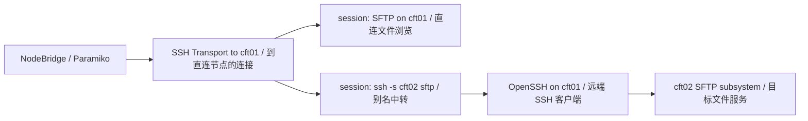
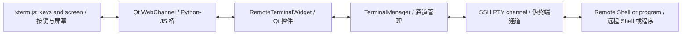

# Architecture / 架构

This document describes the current implementation and explicitly labeled future architecture. The roadmap is in [TODO.md](TODO.md); [CURRENT_STATUS.md](CURRENT_STATUS.md) separates implemented and planned behavior.

本文描述当前实现及明确标注的未来架构。路线图见 [TODO.md](TODO.md)；[CURRENT_STATUS.md](CURRENT_STATUS.md) 区分已实现与计划中的功能。

## Components / 组件

Windows native fault tracing is disabled by default after crash reports localized access violations to CPython's traceback-dump code. `NODEBRIDGE_NATIVE_TRACE=1` enables current-thread-only tracing for diagnosis; other platforms keep all-thread traces. Python, thread and Qt error logging remains enabled. Native-trace descriptions below are conditional on this setting.

崩溃报告将访问冲突定位到 CPython 栈输出代码后，Windows 默认关闭自动原生异常捕获。诊断时可设置 `NODEBRIDGE_NATIVE_TRACE=1` 只捕获当前线程；其他平台保留全线程捕获。Python、线程及 Qt 错误日志保持启用。下文原生栈记录说明以此配置为前提。

`resource_monitor.py` owns a dedicated authenticated jump connection and a two-worker query pool, separate from browsing, transfers, probes, hashes and terminal PTYs. It reads Linux `/proc/stat`, `/proc/meminfo` and boot ID through short exec channels; indirect commands run strict, passwordless OpenSSH on the jump host. CPU uses deltas of the first eight aggregate counters (guest counters are already included), treating idle plus iowait as idle; memory uses `MemTotal - MemAvailable`. See the [Linux proc documentation](https://www.kernel.org/doc/html/v6.8/filesystems/proc.html). Monitoring rounds never overlap; each finishes before a five-second wait. Errors clear displayed data and delay that node for 30 seconds. GUI signals update existing rows, reject cancelled/previous-site results, and show sample timestamps. Disconnect/exit signals cancellation and waits asynchronously for thread cleanup; SSH connection/open-channel timeouts can delay shutdown. This is host-level Linux telemetry, not a scheduler allocation or per-user measurement, and still needs cluster load validation.

`resource_monitor.py` 持有独立认证的跳板连接及两个工作线程的查询池，与浏览、传输、探测、哈希及终端 PTY 分开。短时 exec 通道读取 Linux `/proc/stat`、`/proc/meminfo` 和启动标识；间接查询通过跳板上的 OpenSSH 严格校验主机密钥并免密执行。CPU 取前八项整机计数器差值（guest 已包含），idle 加 iowait 视为空闲；内存按 `MemTotal - MemAvailable` 计算，依据见 [Linux proc 文档](https://www.kernel.org/doc/html/v6.8/filesystems/proc.html)。各轮不重叠，结束后等待五秒；失败清除显示值并对该节点延迟 30 秒重试。GUI 信号原位更新行，拒绝取消或旧站点结果，提示采样时间。断开／退出发出取消信号并异步等待线程释放；SSH 建连／开通道超时可能延迟退出。这是整机 Linux 资源数据，不是调度器分配量或单用户用量，仍需验证集群负载。

For the underlying concepts and maintenance rules, see [SSH layers](#ssh-layers), [transfer isolation](#transfer-isolation), [terminal pipeline](#terminal-pipeline), and [Qt layout and tasks](#qt-layout). These describe the current source implementation; rebuilding is required to put source changes into an existing portable executable.

底层概念及维护原则见本文的 [SSH 分层](#ssh-layers)、[传输隔离](#transfer-isolation)、[终端数据通路](#terminal-pipeline)和 [Qt 布局与任务](#qt-layout)。这些内容描述当前源码实现；已有绿色版可执行程序须重新构建才会包含源码改动。

`nodebridge/__main__.py` starts `app.py`, which creates the Qt application and `MainWindow` in `window.py`. The main window owns the primary remote session, a stack of previous jump sessions, separate work-node sessions, the file panes, and the current background job. Its Files and Terminal tabs switch between `worker_browser.py` and `terminal_workspace.py`. The latter displays the node tree, terminal tabs, and explicit Terminal Groups with selected broadcast recipients. `terminal_session.py` owns live shell channels outside the widgets and polls them for output. `local_browser.py` provides the local directory tree and file list; `drag_drop.py` translates Qt drag data into local paths or a NodeBridge remote-session token and paths.

`nodebridge/__main__.py` 启动 `app.py`，由它创建 Qt 应用及 `window.py` 中的 `MainWindow`。主窗口持有主远程会话、前级跳板会话栈、独立的工作节点会话、文件面板及当前后台任务。“文件”和“终端”标签页分别呈现 `worker_browser.py` 和 `terminal_workspace.py`。后者显示节点树、终端标签及明确的 Terminal Group 和广播接收目标。`terminal_session.py` 在界面组件之外持有实时 Shell 通道，并轮询接收输出。`local_browser.py` 提供本地目录树和文件列表；`drag_drop.py` 将 Qt 拖动数据转换为本地路径，或 NodeBridge 的远程会话标识和路径。

The terminal node tree includes discovered aliases independently of Files-tab worker SFTP sessions. `RemoteSession.open_alias_shell` opens a PTY through the jump transport without first opening worker SFTP. `TerminalManager` retains these channels when a worker's Files-tab connection closes, and closes them when their jump connection closes. Node batch checkboxes choose which terminals to open or close; broadcast recipients are chosen separately in the active group's member list. Both file and terminal node trees use the small shared `node_check_tree.py` widget for Shift range selection. Opening several terminals uses a bounded thread pool inside one top-level job.

终端节点树独立于文件页工作节点 SFTP 会话，包含已发现的别名。`RemoteSession.open_alias_shell` 通过跳板传输通道直接打开 PTY，无需先打开工作节点 SFTP。文件页关闭某工作节点连接时，`TerminalManager` 保留其终端通道；跳板连接关闭时才关闭。节点的批量勾选决定要打开或关闭哪些终端；广播目标则在当前组成员列表中单独选择。文件与终端的节点树共用小型 `node_check_tree.py` 控件实现 Shift 连续勾选。一次打开多个终端时，在一个顶层任务内使用有限线程池。

Broadcast targets are snapshotted as one selected session per node from the active group. `MainWindow` sends an OSC-marked `pwd -P` probe to idle, recognizable Shell prompts and buffers each probe's output until its marker arrives. Different or unknown directories require explicit confirmation. It also compares the visible Conda prefixes captured from recognized prompts; a mismatch offers cancel, send once, or suppress this warning for this in-memory Terminal Group. The directory check remains active when that group warning is suppressed. Common destructive Shell commands require another confirmation before delivery through `TerminalManager`. Each terminal retains its own output. The send status does not track remote command exit codes.

广播目标在发送时固定为当前组内每个选中节点的一个终端。`MainWindow` 对可识别且空闲的 Shell 提示符发送带 OSC 标记的 `pwd -P` 探针，并缓存输出直到收到标记。目录不同或未知时先要求明确确认。程序也会比较从可识别提示符中记录的 Conda 前缀；不一致时可取消、仅此次发送，或对当前内存中的终端组停止该项提醒。关闭组内 Conda 提醒不会关闭目录检查。常见破坏性 Shell 命令还需额外确认，随后才通过 `TerminalManager` 向各目标发送。每个终端保留自己的输出。发送状态不跟踪远程命令退出码。

The probe's echoed command and returning prompt are filtered before terminal rendering. The broadcast controls are below the terminal area. A group's editable name is separate from its generated, abbreviated node suffix, and each terminal tab begins with its group name. After an approved broadcast, `TerminalWorkspace` collects each recipient's raw PTY reply from its current prompt. The read-only xterm.js combined view concatenates those replies in natural node order without adding headings, preserving ANSI sequences. A recognized returning Shell prompt marks that node's reply end; a later broadcast bounds any still-open reply. It does not infer a global execution order or merge identical results.

探针命令回显和返回的提示符会在终端渲染前过滤。广播控件位于终端区下方。终端组可编辑的名称与自动生成、缩写的节点后缀分开，各终端标签以组名开头。广播获准发送后，`TerminalWorkspace` 从各接收终端当前提示符起收集原始 PTY 反馈。只读的 xterm.js 联合视图按节点自然顺序拼接反馈，不额外添加标题，并保留 ANSI 控制序列。识别到 Shell 提示符返回时，该节点本轮反馈结束；仍未结束的反馈以下一次广播为边界。联合视图不推断跨节点的统一执行顺序，也不合并相同结果。

The xterm.js frontend sends Tab and other terminal key sequences through WebChannel to the corresponding PTY; the remote Shell performs completion and its BEL sounds locally. The command helper remembers whether the last input focus belonged to the broadcast field or the current live terminal. It replaces the broadcast draft directly, or sends Shell line-editing keys followed by a template to the selected terminal without Enter. After successful delivery, `MainWindow` restores focus to the broadcast field. The combined view inserts a blank line only after every recipient in that broadcast round has reached a reply boundary.

xterm.js 前端通过 WebChannel 将 Tab 等终端按键序列发送给对应 PTY；补全由远程 Shell 完成，其 BEL 在本地响铃。命令助手记住最近获得输入焦点的是广播框还是当前活动终端。它直接替换广播草稿，或向选中的终端发送 Shell 行编辑按键和模板，但不发送回车。成功发送后，`MainWindow` 将焦点还给广播框。联合视图仅在本轮所有接收节点均到达反馈边界后插入空行。

## Terminal-group boundary / 终端分组边界

`TerminalGroup` in `terminal_workspace.py` records a stable run-local ID, display name, members, and selected broadcast recipients. Each successful connection batch creates a new group; a single new terminal forms its own group. Group selection and the member list are visible in the Terminal tab. Switching groups clears the draft command; there is no separate broadcast-mode checkbox. `MainWindow` receives the group ID with each broadcast request and validates session membership before the cwd probe and again before delivery. There is no implicit global broadcast. Groups are in memory for this run; remote session persistence remains future work.

`terminal_workspace.py` 中的 `TerminalGroup` 记录本次运行内稳定的 ID、显示名称、成员和已选广播目标。每次成功连接一批节点都会创建新组；单独新建终端也形成自己的组。终端页显示组选择和成员列表。切换组会清空输入；不再设单独的广播模式勾选框。`MainWindow` 收到带组 ID 的广播请求，在目录探针前及实际发送前都校验会话成员关系。没有隐式全局广播。组信息只保存在本次运行的内存中；远程会话持久化仍是后续工作。

For later identical-result compression, retain each terminal's raw output and associate a bounded broadcast command with its group and per-session results. A separate comparison layer may normalize presentation-only differences before grouping effectively identical results; continuously interactive terminal streams must remain individually viewable. The current combined view separates broadcast rounds but does not compare or deduplicate their results.

未来对相同结果的压缩展示应保留每个终端的原始输出，并把一次有明确边界的广播命令关联到所属组和逐会话结果。独立的比较层可在归并实质相同结果前归一化仅影响展示的差异；持续交互的终端流仍需可单独查看。当前联合视图已分开各次广播，但尚不比较或去重结果。

`remote.py` owns Paramiko SSH/SFTP connections and directory listings. `sites.py` stores named site profiles, and `site_dialog.py` edits them. `transfer.py` implements local-to-remote, remote-to-local, local-to-local, within-session remote-to-remote, and cross-session remote-to-remote copy operations. `batch.py` runs bounded parallel node tasks and checks move-source metadata. Work-node drop and delete actions in `window.py` choose the scope and pass explicit operations to that engine; `batch_dialog.py` remains in the codebase but has no visible entry point. `file_operations.py` implements rename, directory creation, and deletion. `conflict_dialog.py` asks the user how to handle an existing file; `file_icons.py` provides file-type icons.

`remote.py` 管理 Paramiko SSH/SFTP 连接和目录列表。`sites.py` 保存具名站点资料，`site_dialog.py` 用于编辑资料。`transfer.py` 实现本地到远程、远程到本地、本地到本地、同一远程会话内及不同远程会话间的复制。`batch.py` 并行运行有限数量的节点任务并检查移动来源元数据。`window.py` 中的工作节点拖放和删除操作会选定范围，再向该执行逻辑传入明确操作；`batch_dialog.py` 暂留在代码库，但没有可见入口。`file_operations.py` 实现重命名、新建目录和删除。`conflict_dialog.py` 询问同名文件的处理方式；`file_icons.py` 提供文件类型图标。

Discovery returns candidate aliases, then `RemoteSession.probe_alias` runs noninteractive `ssh ... true` with strict host-key checking. `window.py` gives probing its own SSH connection and background thread, with up to four concurrent aliases; it does not occupy the file-operation job slot. Navigation and view changes submit fresh directory-listing jobs. A merged-directory refresh schedules automatic SHA-256 checks for regular, same-name, same-size files present on every connected node; known missing or size differences do not require hashing. `content_check.py` opens short-lived SFTP sessions through another dedicated jump connection, limits concurrent node sessions and hash channels to two, and batches up to 32 names into each `sha256sum -z` command. It compares the listing snapshot with fresh metadata after hashing: one stat for a single file, or one new listing for several files. Path or node changes cancel or supersede stale checks. The GUI receives only digests and errors and shows results in the difference column. The manual comparison button and JSON report path have been removed. Neither check changes remote files or downloads file contents.

节点发现仅返回候选别名；随后 `RemoteSession.probe_alias` 严格校验主机密钥，执行非交互式 `ssh ... true`。`window.py` 给探测单独分配 SSH 连接和后台线程，最多并行检查四个别名，不占用文件操作任务槽。进入目录和切换视图会重新读取目录。合并目录刷新后，自动核对所有已连接节点上同名、同大小的普通文件；已知缺失或大小不同无需计算哈希。`content_check.py` 通过另一条独立跳板连接创建短期 SFTP 会话，最多同时使用两个节点会话和两个哈希命令，每条 `sha256sum -z` 命令最多处理 32 个文件。它将原目录列表快照与哈希后的新元数据比较：单文件读取一次状态，多文件重新读取一次目录。切换路径或节点会取消或取代过期核对。界面只接收摘要和错误，在差异栏显示结果。手动核对按钮及 JSON 报告流程已移除。两种检查都不修改远程文件，也不下载文件内容。

The work-node file table starts a drag with only a worker token and absolute source paths. After a drop onto the local or jump pane establishes the destination, it asks whether to copy from the focused node or all connected nodes, checks resulting names for cross-node collisions, and starts direct SFTP transfers with up to four concurrent node tasks. `transfer.py` adds `_<alias>` only to each source root: before a file extension for files and after the full name for directories. Each jump destination opens its own SFTP channel on its task's pooled jump SSH connection, so concurrent writes do not share one client. In-app drops use existing overwrite prompts and per-node results. Work-node-to-Explorer dragging is deferred pending Windows integration that does not interrupt the drag. The source is never deleted.

工作节点文件表开始拖动时只携带节点标识和绝对来源路径。投放到本地或跳板面板、确定目标目录后，才询问从当前节点或所有已连接节点复制；程序检查不同节点的目标名称冲突，再以最多四个节点任务直接通过 SFTP 传输。`transfer.py` 只给每个来源顶层项目追加 `_<别名>`：文件放在扩展名前，目录放在完整名称后。每个跳板目标都在该任务的池化跳板 SSH 连接上打开独立 SFTP 通道，避免并行写入共用客户端。软件内投放沿用同名覆盖询问和逐节点结果。工作节点拖到资源管理器的功能暂缓，等待不会中断拖动的 Windows 集成方式；来源不删除。

## Connections and jobs / 连接与任务

Indirect-node connection batches have a dedicated `_worker_connect_job` slot with their own log callbacks. They can overlap local/direct-node actions and existing terminal input. Duplicate worker connection batches, worker disconnect, direct-site replacement/disconnect, and application close wait for that slot, because they change its connection ownership. Probes and hashes retain their separate read-only task slots; file copies retain their transfer slot. Other ordinary file jobs and terminal connection batches still use the existing shared slot and are not yet fully independent.

间接节点批量连接有独立的 `_worker_connect_job` 任务位及日志回调，可与本地／直连节点操作和已有终端输入并行。重复发起间接节点连接、断开间接节点、替换或断开直连站点，以及关闭程序须等待该任务，因为这些动作会改变其连接归属。探测和哈希仍使用各自的只读后台任务位，复制保留独立传输任务位。其他普通文件任务和终端批量连接仍使用原共享任务位，尚未完全相互独立。

Successful connection events carry a monotonically increasing revision; probe replies started before a later success cannot overwrite it. File and terminal node lists consume the same probe state. A bounded in-memory hash-result cache uses live session identity, path, file size, mtime, and type, with a 60-second TTL. It caches only successful comparisons and is invalidated by file operations; metadata-preserving external changes remain a documented limitation.

实际连接成功事件携带递增版本；在之后发生连接成功时，较早启动的探测结果不能覆盖它。文件和终端节点列表使用同一份探测状态。有容量上限的内存哈希结果缓存以实时连接身份、路径、文件大小、修改时间和类型为依据，最多保留 60 秒。仅缓存成功的比较，文件操作会使缓存失效；外部保留元数据的内容修改仍属于已说明的局限。

Command snippets are stored as JSON in the application's QSettings, using the existing source/portable settings location. The manager edits command text, optional description, and toolbar visibility. The broadcast editor is a QPlainTextEdit: Shift+Enter edits, Enter submits, and line endings are normalized to PTY carriage returns after the existing group and directory checks. Destructive-command detection also checks subsequent lines.

常用命令以 JSON 保存于应用的 QSettings，沿用源码版／绿色版已有的设置位置。管理器编辑命令文本、可选介绍及工具栏显示状态。广播编辑器改为 QPlainTextEdit：Shift+Enter 换行，Enter 提交，通过原有组和目录检查后将换行规范化为 PTY 回车。破坏性命令检测也检查后续各行。

For multiline broadcasts, combined output continues accepting replies across intermediate Shell prompts until the next broadcast or direct terminal input. Prompt detection still estimates completion; this is not a command-exit tracking protocol, and unsolicited background output may be included.

多行广播的联合显示会跨越中间 Shell 提示符继续接收反馈，直到下一次广播或该终端收到直接输入。完成状态仍依靠提示符估计，并非命令退出状态协议；期间的异步后台输出也可能被包含。

Direct connections use Paramiko. A saved-site jump opens an SSH `direct-tcpip` channel through the current site and then creates another Paramiko connection. An SSH-alias jump runs the jump site's OpenSSH client and opens a target SFTP subsystem. Multiple work-node alias sessions keep their own SFTP channels while the primary jump session stays open. Browsing assigns at most four work-node SFTP channels per jump SSH connection, opening additional jump connections with the current session credentials held in memory. Copy tasks use a separate pool of authenticated jump connections: only an active task opens its source and destination SFTP channels, closes those channels when done, and returns the jump connection to the pool. Up to four copy tasks run concurrently, so queued nodes hold no transfer channels. The work-node browser merges cached listings at one path or shows a focused node; it also supplies selected file names and node scope to batch operations. It does not yet expose independent full views or inline editing for every node. Discovery combines explicit Host aliases from user/system OpenSSH config with all numbered hostnames in `/etc/hosts`, regardless of prefix. Only if that file provides no numbered hosts does it try bounded `getent hosts` queries derived from the jump hostname. The older sequential jump stack remains available for saved-site connections.

直连使用 Paramiko。经已保存站点中转时，程序通过当前站点打开 SSH `direct-tcpip` 通道，再建立另一个 Paramiko 连接。SSH 别名中转则运行跳板站点上的 OpenSSH 客户端，并打开目标的 SFTP 子系统。多个工作节点别名会话各自保持 SFTP 通道，同时主跳板会话保持连接。浏览连接每条跳板 SSH 连接最多分配四条工作节点 SFTP 通道；需要时使用本次会话的内存凭据建立额外跳板连接。复制任务使用独立的已认证跳板连接池：轮到某个任务时才打开来源和目标 SFTP 通道，完成后关闭通道，并将跳板连接归还连接池。复制最多同时执行四个节点任务，排队的节点不占用传输通道。工作节点浏览器可合并同一路径的已缓存列表，或显示聚焦节点；还会向批量操作提供选中的文件名和节点范围。尚无每个节点独立的完整视图或行内编辑。节点发现结合了用户和系统 OpenSSH 配置中的明确 Host 别名，以及 `/etc/hosts` 中所有带编号的主机名，不限前缀。只有该文件没有编号主机时，才根据跳板节点名称限时运行 `getent hosts` 查询。原有逐级中转栈仍用于已保存站点连接。

`MainWindow._run` starts the ordinary `QThread` job for blocking SSH/SFTP work. Copies use a separate background copy slot, leaving local, direct-node, and indirect-node browsing enabled. Multi-node transfers use dedicated jump connections and SFTP channels, so browsing shares neither their SSH transports nor their SFTP clients; direct-pane copies use a separate SFTP channel on the existing SSH connection. Multi-node copies use up to four node tasks; disconnect and file mutations wait for the copy to finish. Progress and per-node results return through Qt signals. File conflicts are serialized into GUI Overwrite, Skip, or Cancel dialogs. There is still only one active copy slot, with no persistent transfer queue or retry.

`MainWindow._run` 为普通阻塞式 SSH/SFTP 工作启动 `QThread` 任务。复制使用另一后台任务位，传输期间仍可浏览本地、直连和间接节点。多节点传输使用专用跳板连接和独立 SFTP 通道，浏览与这些传输既不共用 SSH 连接，也不共用 SFTP 客户端；直连面板的单目标复制则在原 SSH 连接上打开独立 SFTP 通道。多节点复制最多并行四个节点任务；断开连接和其他文件修改需等复制完成。进度和逐节点结果通过 Qt 信号返回界面。同名文件冲突仍串行进入 GUI 的覆盖、跳过或取消对话框。当前仍只能同时执行一项复制任务，没有持久传输队列或重试。

Work-node directory creation uses the same current-node/all-connected scope chooser as copy and delete. A bounded background precheck verifies the parent directory and probes each target name before any writes; any probe error aborts the whole request. If a name exists, a GUI prompt chooses Skip, Number, or Cancel for the whole operation. The worker in `file_operations.py` rechecks each node when creating, never replaces existing items, and chooses `name (2)`, `name (3)`, etc. independently per node. Creation then runs with up to four node tasks; completed nodes are not rolled back if another node fails. Results appear per node and in the persistent operation log.

间接节点新建目录沿用复制和删除的“当前节点／所有已连接节点”范围选择。后台以有限并发检查各节点的父目录和目标名称，任何预检查错误都会在写入前终止整批请求。同名时 GUI 统一询问跳过、带序号新建或取消。`file_operations.py` 在实际创建时再次检查各节点，不替换已有项目，分别选取 `名称 (2)`、`名称 (3)` 等可用名称。创建阶段最多并行四个节点任务；其他节点失败时，已完成的节点不会回滚。逐节点结果写入结果表和持久操作日志。

File mutations pass a plain-language action description and source/destination context to `_run`, which starts a UI log row and updates it on completion or error. Connection jobs use the same path; broadcast delivery and cancellation add events directly. Batch-result signals append per-node rows in the Files-tab result table; the UI log keeps one grouped summary per batch. `activity_log.py` writes UTF-8 JSON lines for start and finish events with a shared event ID, elapsed time, context, and per-node batch results. Source runs use Qt's application-local data location; portable builds use `data/logs` beside the executable. Log files rotate at 5 MB with five backups. A vertical `QSplitter` resizes the shared UI log, and View actions persist visibility or open the current log file. The UI retains at most 300 entries per run. Terminal command text/output and passwords are not intentionally persisted; broadcast delivery is not an execution result. SFTP and local APIs retain the actual conflict and safety behavior. In local-to-worker copies, the worker session receives bytes from local files; the jump filesystem is not a source.

文件修改向 `_run` 传入自然语言操作说明以及源／目标信息；该入口先新增一条界面日志，再在任务完成或报错时更新。连接任务使用同一入口；广播发送和取消直接新增事件。批量结果信号在文件页结果表中逐节点新增行；界面日志对每批只保留一条归并摘要。`activity_log.py` 把开始和结束事件写入 UTF-8 JSON 行文件，使用共同事件 ID，并记录耗时、上下文及逐节点结果。源码运行时使用 Qt 的应用本地数据目录；绿色版使用可执行文件旁的 `data/logs`。文件达到 5 MB 后轮转，保留五份旧文件。纵向 `QSplitter` 可调整共用日志高度；“查看”菜单可保存显示设置并打开当前日志文件。界面每次运行最多保留 300 条。程序不会主动持久保存终端命令正文／输出或密码；广播发送结果不代表命令执行结果。实际冲突处理和安全行为仍由 SFTP／本地 API 负责。本地复制到工作节点时，工作节点会话直接接收本地文件字节，跳板文件系统不是来源。

Work-node terminal channels are assigned to jump SSH connections with a conservative four-channel budget per connection, also counting work-node SFTP channels on the primary jump transport. Additional authenticated terminal-only jump connections open no SFTP subsystem and close when their last terminal closes. If a channel is refused with SSH open failure code 2, the failed node is retried on a fresh jump connection with bounded attempts; failures remain visible. There is no application-level limit on Terminal Groups or terminal count; actual capacity still depends on the SSH servers and local resources. A new multi-terminal group opens its Combined tab by default; a single-terminal group opens its individual terminal. A multi-terminal group's Combined tab can be hidden and reopened from the tab dropdown while that group exists, and “Disconnect current group” closes only that group's sessions after confirmation.

工作节点终端通道按每条跳板 SSH 连接最多四条的保守额度分配；主跳板传输上的工作节点 SFTP 通道也计入额度。额外的已认证跳板连接专供终端使用，不打开 SFTP 子系统，并在最后一个终端关闭后释放。若服务端以 SSH 通道打开失败代码 2 拒绝连接，失败节点会换一条新跳板连接有限次重试；最终失败仍会显示。程序没有设置终端组数或终端数上限；实际容量仍取决于 SSH 服务器和本机资源。新建多终端组默认打开联合视图，只有一个终端的组则打开其独立终端；多终端组存在期间联合标签保持可用，“断开当前组”经确认后仅关闭本组会话。

Terminal connection setup runs through `_run` so opening a PTY does not block the GUI. Once connected, `TerminalManager` owns each channel and a Qt timer polls ready output without using `_job`; ordered background writes send input from that session's `RemoteTerminalWidget` to its channel. The terminal channels are separate from SFTP. Alias-node shells run jump-host OpenSSH with strict host-key checking and passwordless login. `RemoteTerminalWidget` hosts a local xterm.js page in `QWebEngineView`; Qt WebChannel carries UTF-8 input, raw decoded PTY output, frontend readiness, and resize dimensions. A multi-terminal batch opens its Combined tab first, so individual WebEngine pages load only when selected; output received meanwhile is queued for that session. xterm.js alone owns ANSI/VT screen state, colors, cursor, scrollback, and keyboard mapping. A small Python-side recent-output buffer only recognizes an idle Shell prompt for the existing broadcast directory probe. Combined views use separate read-only xterm.js instances and ordered per-session reply streams. JavaScript, CSS, HTML, and addon-fit are bundled in `nodebridge/assets`; the official PySide6 wheel supplies WebEngine resources. Local tests cover alternate screen, ANSI colors, progress-line updates, input and resize; real full-screen programs still need cluster testing.

终端连接建立过程使用 `_run`，打开 PTY 时不会阻塞界面。连接后 `TerminalManager` 持有各通道，Qt 定时器轮询已就绪的输出，不占用 `_job`；每个会话的 `RemoteTerminalWidget` 输入通过有序后台写入发送到对应通道。终端通道与 SFTP 分开。SSH 别名节点的 Shell 通过跳板节点 OpenSSH 建立，严格校验主机密钥并要求免密登录。`RemoteTerminalWidget` 用 `QWebEngineView` 承载本地 xterm.js 页面；Qt WebChannel 传递 UTF-8 输入、保留控制序列的 PTY 输出、前端就绪事件及尺寸。多终端建组先打开联合标签，单个终端的 WebEngine 页面在被选中时才加载；此前收到的输出按会话缓存。ANSI/VT 屏幕状态、颜色、光标、历史和按键映射只由 xterm.js 管理。Python 仅保留少量最近输出，用于识别空闲 Shell 提示符和已有的广播目录探针。联合视图使用独立的只读 xterm.js，按会话顺序显示反馈。JavaScript、CSS、HTML 及 addon-fit 位于 `nodebridge/assets`；官方 PySide6 wheel 提供 WebEngine 资源。本地测试已覆盖备用屏幕、ANSI 颜色、进度行覆盖、输入和尺寸同步；真实全屏程序仍需集群实测。

A direct jump-site terminal now authenticates on its own terminal-only SSH transport before opening a PTY. Its authentication banner is shown before the Shell stream; the site's earlier SFTP connection remains separate. This preserves the welcome notice and first-login MOTD that may otherwise be consumed during SFTP setup. Closing that terminal releases its dedicated transport. The cluster-specific result still needs live verification.

直连跳板站点的终端现在先建立独立的、仅供终端使用的 SSH 连接，再打开 PTY。认证公告显示在 Shell 输出之前；先前建立的 SFTP 连接仍独立存在。这样可保留可能在 SFTP 建立过程中被消耗的欢迎公告和首次登录 MOTD。关闭终端会释放这条专用连接。实际集群效果仍需验证。

## Packaging and assets / 打包与资源

`app.py` loads the application icon for the Qt application and main window from `nodebridge/assets`. The editable `nodebridge.svg` source is rendered by `design/build_app_icon.py` into `nodebridge.png` and a multi-size Windows `nodebridge.ico`. A future Windows packager must include these assets and set the executable's icon from the ICO file.

`app.py` 从 `nodebridge/assets` 为 Qt 应用和主窗口加载图标。可编辑的 `nodebridge.svg` 由 `design/build_app_icon.py` 生成 `nodebridge.png` 和多尺寸 Windows `nodebridge.ico`。将来的 Windows 打包工具须包含这些资源，并用 ICO 设置可执行文件图标。

The experimental Windows portable edition is built as a PyInstaller one-folder bundle from `nodebridge.spec`; `scripts/build_portable.py` also creates an archive without the mutable `data` directory. It includes Python, PySide6 WebEngine resources, terminal assets, the icon, and required Conda DLLs. Source runs retain per-user settings and data; frozen runs place settings, sites, and logs under `data` beside the executable. The final release still requires clean-machine and live SSH verification. An installer remains optional.

试验性 Windows 绿色版由 `nodebridge.spec` 通过 PyInstaller 打成单目录；`scripts/build_portable.py` 还会生成不含可变 `data` 目录的压缩包。包内包含 Python、PySide6 WebEngine 资源、终端资源、图标及所需 Conda DLL。源码运行继续使用用户目录保存设置和资料；打包运行则保存在程序旁的 `data` 中。正式发行前仍需在干净机器和真实 SSH 环境验证。安装版仍为可选项。

`diagnostics.py` writes rotated WARNING-and-higher Python/Qt diagnostics to `errors.log`, routes uncaught Python and thread exceptions there, and enables best-effort native fault traces in `crash.log`. Caught background-job failures and partial batch outcomes are also recorded. These files share the activity-log directory but are separate from structured user actions; native failures before diagnostics initializes or hard process termination may leave no entry.

`diagnostics.py` 将 Python／Qt 的警告及以上级别信息轮转写入 `errors.log`，也记录未捕获的 Python／线程异常，并尽可能把原生崩溃栈写入 `crash.log`。已捕获的后台任务失败和部分批量失败也会记录。这些文件与结构化操作日志位于同一目录，但用途独立；诊断初始化前的原生故障或进程被强制终止可能没有记录。

The repository separates author guidance in `DEVELOPER_GUIDE.md` from the Chinese-only `USER_GUIDE.md`. The latter is bundled as application data and rendered by a `QTextBrowser` opened from Help, so source and portable runs display the same text. `README.md` remains the short GitHub overview.

仓库以 `DEVELOPER_GUIDE.md` 说明作者／Agent 工作，以纯中文 `USER_GUIDE.md` 面向用户。后者作为程序资源打包，由“帮助”菜单打开的 `QTextBrowser` 显示，因此源码版和绿色版读取同一份正文。`README.md` 仍保持为简短的 GitHub 首页简介。

## Technical principles / 技术原理

## SSH connection, channel, and session / SSH 连接、通道与会话

An authenticated SSH transport is the encrypted carrier, normally over one TCP connection. It can multiplex several logical channels. Each channel has its own identifier and flow-control window, while sharing the transport and its failure boundary. Closing one channel need not close its neighbors; closing their transport disconnects them all. See [RFC 4254, sections 5–6](https://www.rfc-editor.org/rfc/rfc4254.html#section-5) and [Paramiko Transport](https://docs.paramiko.org/en/stable/api/transport.html).

经过认证的 SSH 传输连接是加密的数据载体，通常建立在一条 TCP 连接上；内部可以复用多个逻辑通道。各通道有自己的编号和流量窗口，但共享底层传输连接及其故障范围。关闭一个通道不必关闭其他通道，关闭底层连接则会断开其全部通道。协议依据见 [RFC 4254 第 5–6 节](https://www.rfc-editor.org/rfc/rfc4254.html#section-5)，代码接口见 [Paramiko Transport](https://docs.paramiko.org/en/stable/api/transport.html)。

| Term / 名称 | Meaning in this project / 在本项目中的含义 |
| --- | --- |
| `SSHClient` / SSH 客户端 | Paramiko object handling connection/authentication and access to a Transport. / Paramiko 中管理连接、认证并提供 Transport 的对象。 |
| `Transport` / 传输连接 | Carries encrypted traffic for multiple channels. / 承载多个通道的加密流量。 |
| `Channel` / 通道 | A logical byte stream inside one Transport, not another independent TCP login. / 同一 Transport 内的逻辑字节流，并非另一次独立 TCP 登录。 |
| SSH `session` / 协议会话 | One channel type used for a Shell, command execution, or a subsystem such as SFTP. / 一种通道类型，可承载 Shell、命令执行或 SFTP 等子系统。 |
| `SFTPClient` / 文件协议客户端 | Sends file protocol requests over a channel; directory listing and file transfer use this protocol. / 通过通道发送文件协议请求，列目录和传输文件均使用该协议。 |
| `RemoteSession` / 项目封装 | Python wrapper for configuration and owned/borrowed SSH/SFTP resources; it does not always own a new SSH transport. / 封装配置及拥有或借用的 SSH/SFTP 资源，不一定独占一条新的 SSH 连接。 |
| Terminal `session_id` / 终端会话编号 | Application ID mapping a terminal view to a live PTY channel. / 应用内部把终端视图对应到实时 PTY 通道的编号。 |
| `TerminalGroup` / 终端组 | UI/broadcast membership only; creating a group does not create an SSH transport by itself. / 只表示界面和广播成员关系，创建组本身不会建立 SSH 连接。 |

OpenSSH `MaxSessions` limits Shell/command/subsystem sessions **per SSH network connection**; its documented default is 10. It is not a total-node limit, and forwarding channels are a different category. `MaxStartups` concerns concurrent unauthenticated connections. Server policy can differ, so NodeBridge's four-task budget is an application choice, not a discovered server limit. See [OpenSSH sshd_config](https://man.openbsd.org/sshd_config#MaxSessions).

OpenSSH 的 `MaxSessions` 限制**每条 SSH 网络连接**上的 Shell、命令及子系统会话，文档默认值为 10；它不等于节点总数上限，转发通道属于另一类。`MaxStartups` 则针对尚未完成认证的并发连接。服务器策略可以不同，因此 NodeBridge 的四任务并发预算是应用选择，不是探测得到的服务器上限。依据见 [OpenSSH sshd_config](https://man.openbsd.org/sshd_config#MaxSessions)。

### Two ways to reach an indirect node / 两种中转方式

`RemoteSession.connect_via` opens a `direct-tcpip` forwarding channel, then runs a target Paramiko SSH connection through it. `connect_alias`, used for aliases such as `cft02`, instead opens a **session channel on cft01** and executes `ssh -T ... -s cft02 sftp` there. OpenSSH on cft01 connects to cft02 and relays its SFTP stream. Thus each alias browser consumes an outer session on cft01 as well as resources on the target. Target authentication and host-key checking use cft01's OpenSSH environment, with BatchMode and strict checking; the Windows machine need not resolve `cft02` itself. See [remote.py](../nodebridge/remote.py).

`RemoteSession.connect_via` 打开 `direct-tcpip` 转发通道，再在通道内建立面向目标的 Paramiko SSH 连接。`cft02` 等别名使用的 `connect_alias` 则在 **cft01 上打开 session 通道**，执行 `ssh -T ... -s cft02 sftp`。cft01 上的 OpenSSH 连接 cft02，并转发它的 SFTP 数据流。因此，一个别名浏览连接既占用 cft01 上的外层会话，也消耗目标节点的资源。目标认证和主机密钥校验使用 cft01 的 OpenSSH 环境，并启用 BatchMode 与严格校验；Windows 本机不必能解析 `cft02`。实现见 [remote.py](../nodebridge/remote.py)。

The diagram illustrates a browsing connection; transfer pools use additional transports. `open_sftp_peer()` opens another SFTP channel while borrowing the existing transport. In contrast, `connect_shell_host()` authenticates a new transport without opening an initial SFTP channel. `RemoteSession.close()` closes only the resources that wrapper owns; peer closure must not close the browser's borrowed root transport.

上图示意浏览连接，传输池另用额外的 Transport。`open_sftp_peer()` 借用已有传输连接、另开 SFTP 通道；`connect_shell_host()` 则建立新的认证传输连接，但不额外打开初始 SFTP 通道。`RemoteSession.close()` 关闭封装对象拥有的资源；关闭传输用 peer 时，不能顺带关闭浏览器借给它的根连接。

## Why browsing and copying can coexist / 浏览与复制如何并行

There are three separate problems: keeping blocking I/O off the GUI thread, avoiding concurrent operations on the same SFTP client, and budgeting channels on each SSH transport. Adding a background thread solves only the first. A separate SFTP channel separates protocol request streams, but still consumes the shared transport's session allowance and bandwidth. Dedicated transfer transports also separate that allowance and connection failure boundary; they still share physical network capacity, disks, CPU, and the same remote files.

这里有三个不同问题：不让阻塞 I/O 占用 GUI 主线程、不让多个操作同时使用同一个 SFTP 客户端、控制每条 SSH 连接上的通道占用。增加后台线程只解决第一个问题。独立 SFTP 通道能分开协议请求流，但仍占用共享连接的会话额度和带宽；专用传输连接进一步分开会话额度及连接故障范围。物理网络、磁盘、CPU 和远程文件本身仍是共享的资源。

The previous failure pattern is explained by counting **open** sessions, not running Python workers. For example, eight alias browsers plus one direct SFTP session occupy nine outer sessions. Preopening eight copy peers would request seventeen, even if only four threads subsequently copy data. This illustrates why a thread-count limit alone cannot prevent channel exhaustion; `ChannelException(2, 'Connect failed')` is a generic refusal and does not by itself prove a specific server limit.

之前的失败现象需要数的是**已经打开**的会话，而非正在工作的 Python 线程。例如八个别名浏览加一个直连 SFTP 已占九个外层会话；若预先为八个节点打开复制 peer，就会申请到十七个，即使之后只有四个线程传输数据也一样。这说明仅限制线程数不能阻止通道耗尽；`ChannelException(2, 'Connect failed')` 是通用的连接拒绝信息，单凭它不能断定服务器的具体上限。

Current distribution and collection use [TransferSessionPool](../nodebridge/remote.py) with [run_parallel](../nodebridge/batch.py): at most four active node tasks acquire dedicated authenticated jump transports. A task opens its SFTP source/destination only after it starts; a queued task opens nothing. The task closes its peers, returns its transport to the pool, and the next task reuses it. Nested source/destination access in one task can share that dedicated transport with separate channels. The pool belongs to one batch and closes at its end; it is not a persistent global connection service. Direct-pane single-target copies still borrow a transport and open a separate SFTP peer.

当前分发和汇集使用 [TransferSessionPool](../nodebridge/remote.py) 配合 [run_parallel](../nodebridge/batch.py)：最多四个活动节点任务取用专门认证的跳板连接。任务真正开始后才打开来源／目标 SFTP，排队任务不打开通道。结束时关闭 peer、归还传输连接，后续任务复用连接；同一任务嵌套访问来源和目标时，可在该专用连接上打开两个独立通道。连接池只属于这一批任务，批次结束后关闭，并非全局永久连接服务。直连面板的单目标复制目前仍借用原 Transport、另开 SFTP peer。

Data routing matters: local → worker reads the local file and streams it to the worker through cft01; it does not substitute a same-name file on cft01. Remote → remote in [transfer.py](../nodebridge/transfer.py) currently reads chunks into NodeBridge and writes them to the destination SFTP session, so those bytes pass through the user's computer. It does not run a server-side `scp` or `cp`. In-app streaming does not require a complete temporary local copy; the separate Explorer drag-export path may stage one. Independent connections do not provide a transaction or prevent an external program from changing the same file.

数据路线也很重要：本地 → 间接节点读取本地来源文件，经 cft01 转发写入目标，不会改用 cft01 上的同名文件。[transfer.py](../nodebridge/transfer.py) 当前的远程 → 远程复制，会先把数据块读到 NodeBridge，再写入目标 SFTP，因此这些字节会经过用户电脑；没有在服务器上执行 `scp` 或 `cp`。程序内流式复制无需完整本地临时副本，独立的资源管理器拖出流程则可能预先缓存。独立连接不提供事务，也不能阻止外部程序修改同一个文件。

## xterm.js and the terminal data path / xterm.js 与终端数据通路

The frontend is **xterm.js** (not “xtern”), a terminal emulator, not an SSH client or a local PowerShell process. [terminal.html](../nodebridge/assets/terminal.html) loads local JS/CSS plus Qt's `qwebchannel.js`; [terminal.js](../nodebridge/assets/terminal.js) creates the emulator and fit addon. The bundled versions and MIT notices are recorded in the [asset README](../nodebridge/assets/xterm/README.md). Runtime requires neither npm/Node.js nor a CDN. PySide6 Qt WebEngine supplies the embedded browser; portable packaging must include both its runtime resources and the local terminal assets.

前端名称是 **xterm.js**（不是“xtern”），它是终端模拟器，不是 SSH 客户端，也不是一个本地 PowerShell 进程。[terminal.html](../nodebridge/assets/terminal.html) 加载本地 JS/CSS 及 Qt 的 `qwebchannel.js`；[terminal.js](../nodebridge/assets/terminal.js) 创建模拟器和尺寸适配插件。随程序提供的版本和 MIT 许可证说明见[资源目录 README](../nodebridge/assets/xterm/README.md)。运行时不需要 npm、Node.js 或 CDN；内嵌浏览器由 PySide6 Qt WebEngine 提供，绿色版需同时包含它的运行资源与本地终端资源。

`TerminalManager` orders writes per session on a four-thread send executor. Its 100-ms Qt timer reads only ready channel output, in bounded chunks, and decodes UTF-8 incrementally so split Chinese characters survive packet boundaries. Output keeps ANSI/VT control sequences: xterm.js handles carriage return, cursor movement, erase-line, colors, and alternate-screen state. This is why progress bars can overwrite previous text instead of accumulating log lines. Python's small prompt buffer serves broadcast checks, not screen rendering. `addon-fit` turns the visible area into columns/rows and sends PTY resize requests to the server.

`TerminalManager` 用四线程发送池按各会话顺序写入。其 100 毫秒 Qt 定时器只读取已就绪的通道输出，每次读取有限的数据块，并增量解码 UTF-8，避免跨包的中文字符被拆坏。输出保留 ANSI/VT 控制序列，由 xterm.js 处理回车、光标移动、清行、颜色和备用屏幕，因此进度条能覆盖旧内容，而非不断追加日志行。Python 的少量提示符缓存只用于广播检查，不负责屏幕渲染。`addon-fit` 把可见区域换算为列／行数，再向服务器发送 PTY 尺寸变更。

Tab completion belongs to the remote Shell; clipboard text passes through xterm.js's paste handling. The custom Ctrl+V handler must prevent the browser's default paste as well as stop xterm's normal key mapping, otherwise one keypress sends two copies. Terminal tabs are views of channels: hiding a tab preserves its connection, reopening reuses it, and disconnecting closes the channel. Each combined view is an additional read-only renderer, not an extra remote Shell. Source ownership is in [terminal_session.py](../nodebridge/terminal_session.py), with the bridge in [remote_terminal_widget.py](../nodebridge/remote_terminal_widget.py).

Tab 自动补全属于远程 Shell；剪贴板文本经 xterm.js 的粘贴处理。自定义 Ctrl+V 必须同时阻止浏览器默认粘贴及 xterm 常规按键映射，否则一次按键会发送两份内容。终端标签是通道的视图：隐藏标签保留连接，重新打开会复用它，断开才关闭通道。联合视图只是额外的只读渲染器，不会新增远程 Shell。通道归属实现见 [terminal_session.py](../nodebridge/terminal_session.py)，桥接见 [remote_terminal_widget.py](../nodebridge/remote_terminal_widget.py)。

## Qt windows, models, and background jobs / Qt 窗口、模型与后台任务

`QApplication` owns the GUI event loop; `MainWindow` is a `QMainWindow`. `QTabWidget` switches Files/Terminal workspaces, and nested `QSplitter` widgets control horizontal pane widths and the vertical workspace/log ratio. The local pane uses Qt filesystem models; remote trees/tables display `DirectoryListing` snapshots returned from network tasks. Reading fresh listings and deciding whether hashes can be reused are separate steps. Settings use `QSettings`, while site credentials have their own store. See [window.py](../nodebridge/window.py), [local_browser.py](../nodebridge/local_browser.py), and [worker_browser.py](../nodebridge/worker_browser.py).

`QApplication` 持有 GUI 事件循环，`MainWindow` 是 `QMainWindow`。`QTabWidget` 切换文件／终端工作区，嵌套的 `QSplitter` 控制横向面板宽度及纵向工作区／日志比例。本地面板使用 Qt 文件系统模型，远程树和表格展示网络任务返回的 `DirectoryListing` 快照；刷新目录信息与判断是否复用哈希是两个独立步骤。界面设置使用 `QSettings`，站点凭据另有存储。实现见 [window.py](../nodebridge/window.py)、[local_browser.py](../nodebridge/local_browser.py) 和 [worker_browser.py](../nodebridge/worker_browser.py)。

`JobThread.run()` executes blocking work and emits success/failure signals; GUI callbacks update widgets on the main thread. A responsive event loop does not imply that every control is enabled: `_update_controls` applies task/connection ownership rules. A batch's inner thread pool gives node-level parallelism. File-conflict workers signal the GUI and wait for a choice; they do not construct dialogs themselves. Changes to thread policy must also review shutdown, stale callbacks, overlapping logs, and the lifetime of all referenced sessions.

`JobThread.run()` 执行阻塞工作并发送成功／失败信号，GUI 回调在主线程更新控件。事件循环能响应不代表所有控件都可操作：`_update_controls` 会按任务和连接归属决定可用状态；批次内部线程池提供节点级并行。同名冲突由工作线程通知 GUI，再等待用户选择，而不是由工作线程自行创建对话框。修改线程策略时，必须同时检查退出流程、过期回调、并行日志及所有被引用会话的生命周期。

| Task slot / 任务位 | Current isolation / 当前隔离边界 |
| --- | --- |
| `_job` | Ordinary browsing/mutations and terminal connection setup share this slot; many controls temporarily disable. / 普通浏览、文件修改和终端建连共用，期间仍会暂时禁用较多控件。 |
| `_worker_connect_job` | File-page indirect-node connection setup; local/direct actions remain usable, while changing its parent connection waits. / 文件页间接节点建连；本地／直连操作可用，改变其父连接须等待。 |
| `_copy_job` | One copy batch; browsing remains available, more copies and file mutations wait. / 一批复制；仍可浏览，更多复制和文件修改需等待。 |
| `_probe_job`, `_hash_job` | Separate read-only jobs with dedicated connections and stale-result checks. / 使用独立连接及过期结果检查的只读任务。 |
| Live terminals / 已连接终端 | Output timer and ordered input writes are independent of `_job`; opening new terminals still uses it. / 输出定时器和有序输入不占 `_job`，新建终端仍占用它。 |

The terminal tab bar uses `BoundedTerminalTabBar` so many long labels cannot turn into a minimum window width larger than the monitor. Scroll buttons and the tab-list menu provide overflow navigation; resizing the terminal viewport also resizes the remote PTY. Compact tables use explicit header section sizes instead of an uncontrolled content-based minimum. These are Qt layout concerns, independent of how many SSH channels are open.

终端标签栏使用 `BoundedTerminalTabBar`，避免大量长标签把窗口最小宽度撑到超过屏幕。滚动箭头及标签下拉菜单负责溢出导航；终端可见区域变化还会同步远程 PTY 尺寸。紧凑表格使用明确的行标题尺寸，避免内容计算出过大的最小行高。这些是 Qt 布局问题，与打开多少 SSH 通道属于不同层面。

### Maintenance checkpoints / 维护核对要点

- Count live channels per transport as well as active tasks; do not open peers for every queued node.
- Keep one SFTP client out of concurrent independent operations; preserve host-key verification on every new connection.
- Closing a view, channel, transport, and application are different operations with different dependents.
- Validate with bounded concurrency and error-path tests; simulated tests do not establish the cluster's actual SSH limits.

- 同时统计每条 Transport 的实时通道和活动任务，不要为全部排队节点预开 peer。
- 不让独立并发操作共用同一个 SFTP 客户端；新连接仍须校验主机密钥。
- 关闭视图、通道、传输连接和应用是四种不同操作，影响的依赖对象不同。
- 用有界并发和异常路径测试验证；模拟测试不能证明集群的实际 SSH 限额。

## Storage and safety / 存储与数据安全

An experimental portable build now exists; packaging and clean-machine verification are tracked in [PORTABLE.md](PORTABLE.md). The storage paths below describe runtime behavior, not a requirement to install Python on the user's machine.

现已有试验性绿色版构建，打包及干净机器验收见 [PORTABLE.md](PORTABLE.md)。以下存储位置描述运行时行为，不表示用户机器需要安装 Python。

Source runs keep sites outside the repository in the user's `NodeBridge/sites.json` under Qt's generic configuration location (Windows on this machine: `%LOCALAPPDATA%\NodeBridge\sites.json`). A frozen executable resolves the site file to `data/sites.json` beside the executable. Site files support plaintext, no-save, and master-password modes. The master mode derives a key with Scrypt and encrypts each password with Fernet; the salt and an encrypted verification token live in the version-2 site file. The master key remains in memory for the run. Local-pane visibility and its last successful directory use `QSettings`; an unavailable saved directory falls back to the home directory. Remote drag export from the primary site uses temporary local files removed at exit.

源码运行时，站点资料位于仓库之外、Qt 通用配置目录下的用户 `NodeBridge/sites.json` 中（本机 Windows 路径为 `%LOCALAPPDATA%\NodeBridge\sites.json`）。冻结打包的程序将站点文件定位到可执行文件旁的 `data/sites.json`。站点文件支持明文、不保存及主密码模式。主密码模式用 Scrypt 导出密钥，并用 Fernet 加密每个密码；盐和加密的验证值保存在 v2 站点文件中。主密钥仅在本次运行时留于内存。本地面板显示设置及最近一次成功打开的目录使用 `QSettings`；保存的目录不可用时回到用户主目录。主远程站点拖出文件会使用临时本地副本，并在 NodeBridge 退出时清理。

Unknown or changed SSH host keys are rejected. Deletes require confirmation: remote deletion is recursive and permanent, while local deletion moves items to the Recycle Bin. The underlying move engine requires separate confirmation and is limited to one destination, but the current drag-and-delete UI does not expose it. It deletes the source only after the copy has no failures, skips, or cancellations and the source-tree metadata remains unchanged. Multi-node distribution and collection only copy; multi-source move is planned. Same-name regular files require a choice before replacement; replacement is staged before the original is replaced. Copying symbolic links and special files is currently rejected. Multi-node operations are not transactional: completed work remains after a later failure, and metadata checks are not content-hash verification.

未知或变化的 SSH 主机密钥会被拒绝。删除需要确认：远程删除递归且永久生效，本地删除移入回收站。底层移动执行逻辑另需确认，且仅支持一个目标，但当前拖放和删除界面尚未提供入口；复制没有失败、跳过或取消，并且来源目录树元数据未变化时才删除来源。多节点分发和汇集都只复制；多来源移动仍待实现。同名普通文件替换前需要用户选择，且先暂存新文件再替换原文件。目前不复制符号链接和特殊文件。多节点操作不具备事务性：后续失败不会回滚已完成内容，元数据检查也不等于内容哈希校验。
